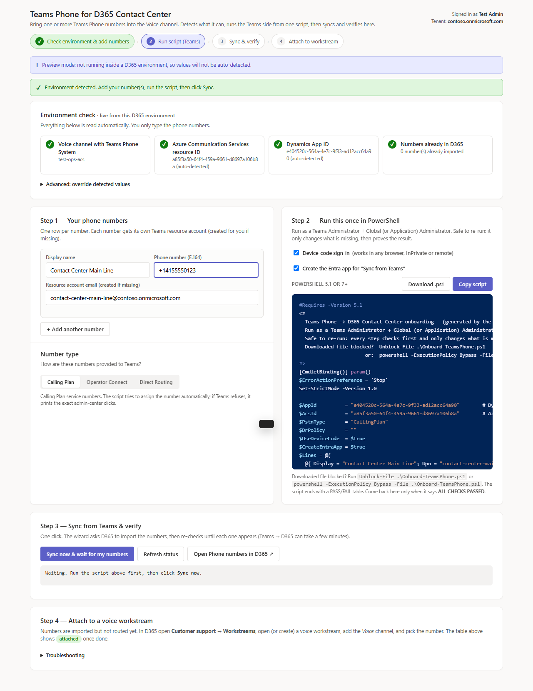

# Teams Phone for D365 Contact Center

A friendly, point-and-click setup wizard that brings a **Teams Phone** number into your **Dynamics 365 Contact Center Voice channel** — without you having to read a single Microsoft doc.

You install it once, open it from inside D365, fill in two boxes, and the wizard does the rest.



> **Prefer not to install anything?** Skip the HTML wizard and paste [**docs/COPY-PASTE-PROMPT.md**](docs/COPY-PASTE-PROMPT.md) into Microsoft Scout, GitHub Copilot CLI, Claude or any tool-capable LLM. It interviews you, then does the whole setup (Entra app, resource account, license, binding, number assignment, D365 sync and verification) for you. You just paste, answer questions and approve sign-ins.

---

## Why this exists

Wiring a Teams phone number into the D365 Voice channel officially involves:

- a half-page PowerShell script you have to hand-edit,
- an Entra (Azure AD) app you have to register and consent,
- four different admin portals,
- and three GUIDs that nobody remembers.

This wizard collapses all of that into **one screen**. It auto-detects the ACS resource ID, Dynamics App ID and voice-channel status from your environment, asks you only for your phone number(s), generates one self-verifying PowerShell script for your Teams admin, then runs the D365 sync and checks the result for you.

---

## Before you start

You need the following **once per tenant**. None of this is created by the wizard — these are the prerequisites the official Microsoft flow assumes.

| You need | Why |
|---|---|
| **Dynamics 365 Contact Center** with the **Voice channel** already provisioned | The wizard plugs into your existing voice setup (it does not create one). |
| A Teams **service number** (usage: **Voice app**) | The wizard does **not** order phone numbers. They must already exist in your Teams tenant. User (DID) numbers are not supported. A Calling Plan service number with *Voice app* usage works with no call queue or auto attendant (verified). → [Get service numbers for Teams](https://learn.microsoft.com/microsoftteams/getting-service-phone-numbers) |
| **Teams Administrator** + **Global Administrator** in your Microsoft 365 tenant | Needed to register the app and run the onboarding script. Use the *tenant's own* admin account, not a guest or your home-tenant account. |
| One free **Microsoft Teams Phone Resource Account** license | Needed to attach the phone number to the resource account. |
| **PowerShell 5.1 or 7+** with access to PSGallery (or the `MicrosoftTeams` and `Microsoft.Graph.*` modules installed) | The generated script installs what it needs. If PSGallery is blocked by policy, install the modules from your internal feed first. |

### What must exist in Teams first (Microsoft documentation)

The wizard creates the resource account, license and binding for you, but the **phone number itself** has to be in your Teams tenant before you start. Read these first if you are new to Teams Phone:

| Topic | Microsoft Learn |
|---|---|
| Get a **service phone number** for Teams (Calling Plan, Operator Connect or Direct Routing) | [Get service phone numbers](https://learn.microsoft.com/en-us/microsoftteams/getting-service-phone-numbers) |
| What a **resource account** is, how to create one, and how to assign a phone number to it | [Manage resource accounts in Teams](https://learn.microsoft.com/en-us/microsoftteams/manage-resource-accounts) |
| The free **Microsoft Teams Phone Resource Account** license | [Teams Phone Resource Account license](https://learn.microsoft.com/en-us/microsoftteams/teams-add-on-licensing/virtual-user) |
| The official end-to-end flow this wizard automates | [Configure Teams Phone in the voice channel (Dynamics 365 Contact Center)](https://learn.microsoft.com/en-us/dynamics365/contact-center/administer/configure-teams-phone-in-voice-channel) |

---

## Install the wizard (5 minutes, one time)

### Step 1 — Download the solution

Grab one of the two zips from the latest release:

➡️ **[Download latest release](https://github.com/moliveirapinto/teams-phone-d365-wizard/releases/latest)**

| File | When to pick this one |
|---|---|
| `mauTeamsPhoneSetup_*.zip` (**unmanaged**) | **Recommended for most people.** You can edit the wizard, restyle it, change copy, or add fields directly in your environment. Easier to uninstall by simply deleting the components. |
| `mauTeamsPhoneSetup_*_managed.zip` (managed) | Strict ALM environments where admins want a sealed, read-only solution they can cleanly remove. The wizard cannot be customized in-place — you'd need to re-import an unmanaged version to tweak it. |

Not sure? Pick the **unmanaged** zip. You can always switch later.

### Step 2 — Import it into your environment

1. Open the **Power Apps maker portal** → https://make.powerapps.com
2. In the top-right environment picker, **select the same environment that hosts your D365 Contact Center**.
3. In the left menu, click **Solutions**.
4. Click **Import solution** at the top.
5. Click **Browse**, choose the `.zip` you just downloaded, then click **Next** and **Import**.
6. Wait for the green **"Solution imported successfully"** banner (usually under a minute).

That's it. The wizard is now installed in your environment.

---

## Open the wizard

After import, the wizard lives at a fixed URL inside your D365 environment:

```
https://<your-org>.crm.dynamics.com/WebResources/mau_TeamsPhoneSetup.html
```

Replace `<your-org>` with whatever appears in your D365 URL (for example, `contoso` if your D365 home page is `https://contoso.crm.dynamics.com`).

> 💡 **Tip — bookmark it.** Once you have the working URL, save it as a browser bookmark called "Teams Phone setup" so admins can find it again next time.

> 💡 **Tip — easier way to find the URL.** If you don't know your org URL by heart:
> 1. Open the **Power Apps maker portal** → **Solutions** → click **Teams Phone for D365 Contact Center**.
> 2. Click **Web resources** in the left panel.
> 3. Click `mau_TeamsPhoneSetup.html` → copy the **URL** field — that's the link to share with your Teams admin.

---

## Use the wizard

The page checks your D365 environment on load, so there is nothing to copy from other screens. You type **only your phone number(s)**.

### What it detects for you (read-only, live from Dataverse)

| Check | Source |
|---|---|
| Voice channel with Teams Phone System provisioned | Active `msdyn_occommunicationprovidersettings` row, provider *Teams Phone System* |
| **Azure Communication Services resource ID** | The same active provider row (`immutableid`) |
| **Dynamics App ID** | `msdyn_occommunicationprovidersettingentries` where key = `DynamicsAppId` |
| Numbers already imported / already attached to a workstream | `msdyn_ocphonenumbers`, `msdyn_ocvoicechannelsettings` |

If anything cannot be detected, an *Advanced: override* box opens so you can paste the value manually.

### The four steps

1. **Add your numbers** — one row per number (display name, phone number, resource-account email which is suggested for you). Pick the number type (Calling Plan, Operator Connect or Direct Routing). Add as many numbers as you need.
2. **Run the script once** — **Copy script** or **Download .ps1**, run it in PowerShell 5.1 or 7+ as a Teams Administrator + Global/Application Administrator. It:
   - installs missing modules (with a clear message if PSGallery is blocked),
   - signs in with **device code** by default (works in InPrivate or remote sessions),
   - creates the Entra app + admin consent for *Sync from Teams* (idempotent),
   - creates each resource account, sets usage location, assigns the free license, **binds it to the Dynamics app *and* the ACS resource** (`-AcsResourceId`), retrying until it sticks,
   - assigns the number (Calling Plan, Operator Connect or Direct Routing; if Teams refuses it prints the exact admin-center clicks),
   - **re-reads everything from Teams and prints a PASS/FAIL table**. Come back to the wizard only when it says **ALL CHECKS PASSED**. The script is safe to re-run.
3. **Sync & verify** — click **Sync now & wait for my numbers**. The wizard calls D365's own *Sync from Teams* action, then re-checks until each number appears, retrying for up to ~10 minutes (Teams → D365 is not instant). A table shows each number as *imported* and *attached*.
4. **Attach to a voice workstream** — in D365, Customer support → Workstreams. The wizard flips the number to **attached** when done.

> Calling Plan numbers: the script tries `Set-CsPhoneNumberAssignment` first. If your tenant refuses, assign the number from **Teams admin center → Voice → Phone numbers →** select the number **→ Edit → Assigned to: Resource account**, then click Sync again. (The *Assign a phone number* button on the resource account's own page opens a panel whose type dropdown is disabled.)

> ⚠️ Resource account type shows **Other** in Teams admin. That is correct. **Never** change it to *Call queue* or *Auto attendant* in the Teams UI: it swaps the account's `ApplicationId` to the Call Queue app (`11cd3e2e-…`) and breaks the D365 binding. Re-running the script repairs it.

### Manual verification (optional)

```powershell
Connect-MicrosoftTeams -UseDeviceAuthentication
Get-CsOnlineApplicationInstance -Identity <resource-account-upn> | fl AcsResourceId,ApplicationId,PhoneNumber
```

`ApplicationId` must equal the Dynamics App ID (never `11cd3e2e-…`), `AcsResourceId` must equal the ACS resource ID (not `ACS_Resource_ID_Not_Set`), and `PhoneNumber` must be `tel:+<your number>`.

### How you know it worked

The number appears under **Channels → Phone numbers** with *Type: Teams* and *Status: Ready for setup*, and the wizard's table shows **imported**.

---
## Updating to a new version


When a new release is published:

1. Download the new zip (**same flavour you originally installed** — unmanaged or managed) from [Releases](https://github.com/moliveirapinto/teams-phone-d365-wizard/releases).
2. In **Power Apps → Solutions → Import solution**, upload the new zip on top of the old one. Power Platform will prompt **"Upgrade"** — accept it.
3. The wizard URL stays the same. Just refresh the page.

> ⚠️ Don't mix flavours. You cannot import a managed zip on top of an unmanaged one (or vice-versa) — Power Platform will reject it. If you really need to switch, uninstall the old solution first.

---

## Uninstalling

**Power Apps maker portal → Solutions →** check **Teams Phone for D365 Contact Center → Delete**. Web resources will be removed; resource accounts and phone numbers you created in Teams are *not* touched.

---

## Troubleshooting

| Symptom | What to do |
|---|---|
| Wizard page shows **"Voice channel not detected"** | The Voice channel has not been provisioned in this environment yet. Use the link the wizard shows to open the Customer Service workspace and complete voice setup first. |
| PowerShell script fails with **"insufficient privileges"** | The person running the script is not a Teams Administrator + Global Administrator. Have the right person re-run it. |
| `New-CsOnlineApplicationInstance: ... license required` | The resource account is missing the Teams Phone Resource Account license. Add the (free) license in M365 admin center > Billing > Purchase services if the tenant has none, then re-run the script. It assigns the license for you. |
| The number does not appear in D365 after the script succeeds | Use the wizard's **Step 3 — Sync now & wait for my numbers**: it retries for ~10 minutes. Teams → D365 sync is not instant; in testing it took a few minutes after the Teams side was fixed. |
| Sync says **"No new phone numbers were found in Teams Admin Center to sync"** | This message is generic. It also appears when D365 cannot match the account. Re-run the script (it verifies and repairs the binding) or run the *Manual verification* above: the usual causes are a wrong `ApplicationId` or `AcsResourceId` = `ACS_Resource_ID_Not_Set`. Fix with `Set-` / `Sync-CsOnlineApplicationInstance ... -AcsResourceId`, wait a few minutes, sync again. |
| Sync response is `TotalTeamsNumbers: null` (browser dev tools, `CCaaS_SynchronizePhoneNumbers`) | Same root cause as above: D365 found no Teams numbers bound to the ACS resource. |
| **Resource account type** shows **Other** in Teams admin | That is expected for an account bound to the Dynamics app. **Do not** change it to *Call queue* or *Auto attendant* in the Teams UI: it swaps the account's `ApplicationId` to the Call Queue app and breaks the D365 binding. If that already happened, re-run the `Set-` / `Sync-CsOnlineApplicationInstance` commands above. |
| Call queue picker shows **"No results"** for the resource account | Same reason: the account is bound to the Dynamics app, not the Call Queue app. You do not need a call queue for this flow. |
| D365 banner: **"Some components of this app require you to sign in"** | Click **Sign in** once (it opens a short Power Apps auth popup; allow popups). It is not what blocks the sync, so continue even if the banner stays. |
| `Install-Module` fails: **"Unable to find repository 'PSGallery'"** | PSGallery is blocked or unregistered on this machine. Install the Graph modules from your internal feed, or run the Entra step from a machine that has PSGallery. |
| **"You don't have access to the Teams admin center"** (`INVALID_PRIVILEGE`) right after sign-in | Usually a transient deep-link error. Open the Teams admin center dashboard first and navigate with the menu. If it persists, the account lacks the Teams Administrator role. |

For deeper reading on the underlying flow:

- 📘 [Configure Teams Phone in the voice channel (Microsoft Learn)](https://learn.microsoft.com/dynamics365/contact-center/administer/configure-teams-phone-in-voice-channel)
- 📘 [Microsoft sample onboarding script (GitHub)](https://github.com/microsoft/Dynamics365-Apps-Samples/blob/master/contact-center/TeamsPhoneSystem-TeamsAdminCenterOnboardScript.ps1)

---

## For contributors

> Skip this section if you just want to use the wizard.

The repo also contains the source web resource and the two helper scripts used to publish and pack new releases.

```
webresource/
  mau_TeamsPhoneSetup.html      # the wizard UI (the one and only thing end-users see)
  mau_teamsphone_example.png    # screenshot used inside the wizard

dist/                           # the built solution zips that go on Releases
docs/                           # README assets

tests/                          # mock Dataverse server + smoke test
upload.ps1                      # publish the HTML + PNG into a Dataverse env
create-solution.ps1             # repack the solution and export new zips into dist/
```

Both helper scripts are tenant-agnostic — they take `-OrgUrl` and use `az account get-access-token` for auth. Typical dev loop:

```powershell
az login --tenant <your-tenant>
.\upload.ps1          -OrgUrl https://<your-org>.crm.dynamics.com
.\create-solution.ps1 -OrgUrl https://<your-org>.crm.dynamics.com -Export
```

### Test without a D365 environment

`tests/` has a mock of the Dataverse endpoints the wizard reads and a smoke test (auto-detection, script generation + PowerShell syntax check, in-wizard sync flow):

```powershell
npm i playwright-core
Start-Process node tests/mock-d365-server.js   # http://127.0.0.1:8765
node tests/smoke.js
```

---

## License

MIT.
